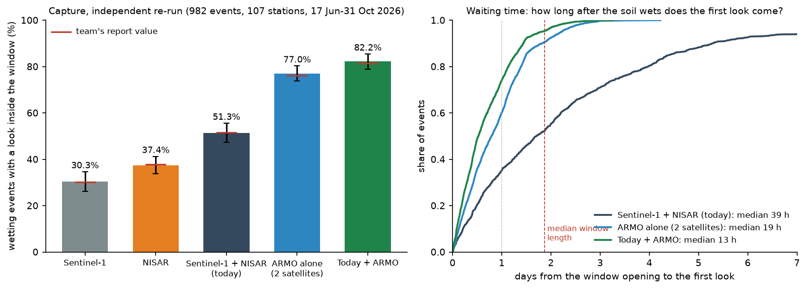

# ARMO validation: does a two-satellite L-band radar really catch more wetting events?

An independent re-check of the analysis behind **ARMO** (Agricultural Rapid Moisture Observatory), the two-satellite
L-band SAR mission proposed by ES4304 Group 2, plus tests the proposal does not have yet. The code here was written
from scratch from the definitions in the team's report, not copied from the team's repository
([zheniannn/ARMO](https://github.com/zheniannn/ARMO)), so agreement between the two is a real check. Everything uses
open data: NOAA USCRN hourly ground truth, real Sentinel-1 and NISAR acquisition records, and NISAR and Sentinel-1
images.

## Main results

| | Today (Sentinel-1 + NISAR) | ARMO alone (2 satellites) | Today + ARMO |
|---|---|---|---|
| Wetting events with a look inside the window | 51.3 % (95 % CI 47.3–55.6) | 77.0 % (73.7–80.3) | 82.2 % (78.9–85.4) |
| Median wait from wetting to first look | 39 h | 19 h | 13 h |
| Events looked at within 24 h | 35 % | 60 % | 74 % |
| Mean gap between looks | 2.81 days | 1.42 days | 0.93 days |
| Worst gap at any station | 20.0 days | 4.5 days | 4.5 days |

982 wetting events at 107 USCRN stations, 17 June–31 October 2026 (the continuous NISAR record). Today's fleet uses
real look times; ARMO is simulated (620 km dawn-dusk orbit, 25–45° off-nadir, 8 starting positions).



- **The team's numbers reproduce** within one point (team: 51.6 %, 76.1 %, 81.5 %, gain +29.9; here +30.9, 95 % CI
  28.0–33.6).
- **Two satellites are needed.** Event by event, two satellites beat the best single satellite by 8.4 points alone
  (95 % CI 7.1 to 9.7). One satellite matches two only by imaging about twice the ground per pass.
- **The gain holds** under every wetting-window rule tried (+24 to +31 points) and without NISAR (Sentinel-1 + ARMO
  79.4 %).
- **"Below 1.4 days" depends on latitude**: 1.42 days on average, 1.54 in the south and 1.27 in the north.
- **Orbit traps.** Altitudes near short repeat cycles capture far less (560 km: 60.3 %, 720 km: 48.3 %). An exact
  6-day repeat orbit at 613 km keeps capture and gives a same-geometry image every 3 days instead of every 45.
- **Noise.** Real NISAR pairs show the measured change noise is not speckle (about 1.6 dB at the station at every
  resolution from 100 to 500 m), so more looks will not fix it. A 200 m product at 40 MHz is the right target.

## Documents

| File | What it answers |
|---|---|
| [docs/FINDINGS.md](docs/FINDINGS.md) | All results with tables and figures: capture, waiting time, latitude, event definition, design sweeps, orbit traps, measured noise, caveats |
| [docs/SUGGESTED_CHANGES.md](docs/SUGGESTED_CHANGES.md) | What the proposal should keep, reword and change, with the supporting numbers |
| [docs/DATA_ACCESS.md](docs/DATA_ACCESS.md) | Which radar data we can actually get, and NISAR's measured gaps (2026 hole, revisit, delivery delay) |
| [docs/RESOLUTION_AND_FEASIBILITY.md](docs/RESOLUTION_AND_FEASIBILITY.md) | Resolution target, swath and looks, power, why agencies do not fly more satellites, one vs two satellites, spacecraft numbers (sourced) |

## Run it

Python 3.11+ with `numpy pandas pyarrow scipy matplotlib pyproj h5py rasterio`. Steps 1–6 and 9–11 need no login.
Step 7 needs a free NASA Earthdata login in a netrc file (`EARTHDATA_NETRC`, default `~/.netrc`); it is never
printed or stored in the repository.

```
python code/01_ground_truth.py         # USCRN hourly files 2025-2026 (about 600 MB) -> quality-controlled table
python code/02_events.py               # wetting events under six window rules, dry-down fits
python code/03_fleet_looks.py          # real Sentinel-1, NISAR and ALOS-2 look times at every station
python code/05_capture.py              # capture, waiting time and gaps for today, ARMO designs A-E and both
python code/06_event_definition.py     # the 50 % rule checked three ways
python code/09_design_sweeps.py        # satellites, swath, altitude, time of day, look side, one-satellite options
python code/09b_altitude_resonance.py  # altitude in 5 km steps
python code/07_nisar_windows.py        # NISAR GCOV windows at 16 stations (range reads, about 5 GB transferred)
python code/08_noise_vs_resolution.py  # change noise against resolution, measured
python code/12_s1_pair_noise.py        # Sentinel-1 RTC windows; then code/12b_s1_noise_by_interval.py
python code/13_review_checks.py        # paired and sensitivity numbers; code/13b_usable_strip.py
python code/10_figures.py && python code/11_headline.py && python -m pytest -q tests
```

`code/04_orbit_sim.py` is the orbit model (J2 sun-synchronous, zero-Doppler looks); `code/sar_tradeoff.py` makes the
feasibility tables and `figures/feas_*.png`. Every number quoted in the documents is collected in
`data/processed/headline.json`, and `tests/test_numbers.py` checks the documents against it. Raw downloads go to
`data/raw/` and are not committed.

## Data sources

| Data | Source | Access |
|---|---|---|
| USCRN hourly02 soil moisture and rain | NOAA NCEI, https://www.ncei.noaa.gov/pub/data/uscrn/products/hourly02/ | Open |
| Sentinel-1 look times, RTC backscatter | Microsoft Planetary Computer (`sentinel-1-grd`, `sentinel-1-rtc`), CC BY 4.0 | Open |
| NISAR look times; GCOV backscatter | NASA CMR; ASF (`NISAR_L2_GCOV_PROVISIONAL_V1`) | CMR open; ASF free Earthdata login |
| ALOS-2 ScanSAR look times | NASA CMR (`ALOS2_L1_PSR2`) | Open metadata |

## Evidence labels

**OBSERVED** (ground truth, real acquisitions), **SIMULATED** (orbit model), **MEASURED** (real radar images),
**ASSUMED** (stated assumption). Main limits: one season (Jun–Oct 2026), few cropland stations, capture is not
detection, and the ARMO runs assume the whole swath is imaged on every pass. See `docs/FINDINGS.md` section 10.
