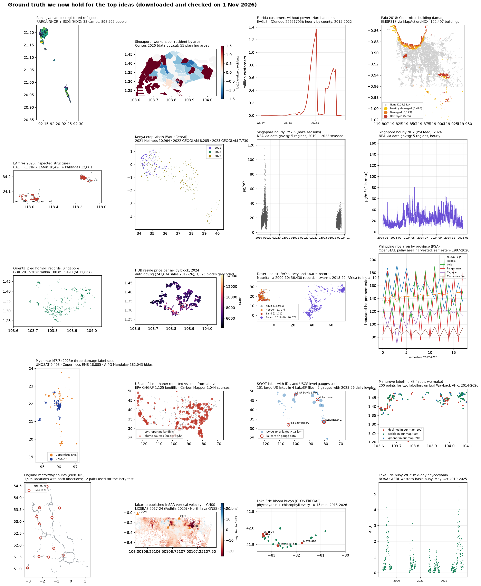
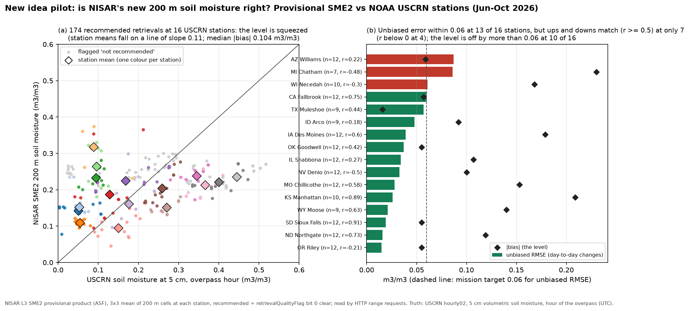

# How ARMO was chosen (October–November 2026)

The group did not start from a satellite. It started from problems, tested which ones had ground truth and open data,
and narrowed them down.

1. **First ideas.** Under the course's poverty theme, Kenneth suggested agriculture and disasters through soil
   moisture, with crowd monitoring as an alternative; these became a soil track and a people track on the group's
   decision board (24 October).
2. **Concept notes (22 October).** Three short proposals in the course template: counting people from orbit, estimating
   building occupancy, and inferring the water table beneath vegetation (tropical peat wetness and fire).
3. **Reading and data checks (25–29 October).** A 53-paper annotated bibliography and a check of NISAR archive access
   for three study regions.
4. **Idea bank and pilots (to 2 November).** 51 ideas, the group's own included, scored against the marking rubric with
   their ground-truth sources named. Data access was tested for 47, and 32 got at least one pilot analysis on public
   data (8 go, 21 maybe, 22 no-go). The group's shortlist had five concepts: crowds, soil moisture, mangrove stress,
   desert locust and harmful algal blooms.
5. **The choice.** After discussion in the group and a consultation with the course TA, the group chose soil moisture
   for agricultural and disaster use. Tang Zhen Ian built the ARMO analysis in
   [zheniannn/ARMO](https://github.com/zheniannn/ARMO), and the group presented ARMO on 5 November. The gap it
   addresses, wetting events that end before a satellite looks, also matters to alternate wetting and drying (AWD)
   rice irrigation, a related field project.
6. **Cross-check and report support (7–8 November).** This repository: a second implementation of the capture analysis,
   additional tests, and the scripts behind the final report's engineering, budget and revisit numbers.

## Two pieces of the earlier work

*Ground truth downloaded and checked for the leading ideas on 1 November 2026: one panel per dataset (refugee camps,
census and housing, power outages, building damage, fire damage, crop labels, air quality, species records, locust
surveys, rice statistics, methane plumes, lakes, mangrove labels, traffic counts, subsidence and algal blooms). All are
public datasets; sources are printed on each panel.*

*The soil-moisture pilot that pointed towards ARMO: NISAR's provisional 200 m soil-moisture product (SME2) against
NOAA USCRN stations, June–October 2026. The unbiased error was within 0.06 m³/m³ at 13 of 16 stations, but the level
was off by more than 0.06 at 10 and the ups and downs matched (r ≥ 0.5) at only 7; with a 12-day repeat, most short
wetting events also go unobserved, which is the gap ARMO studies.*
