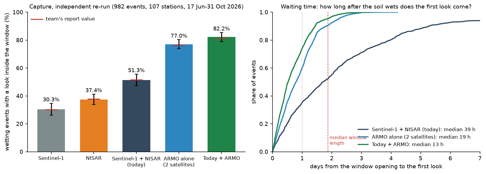
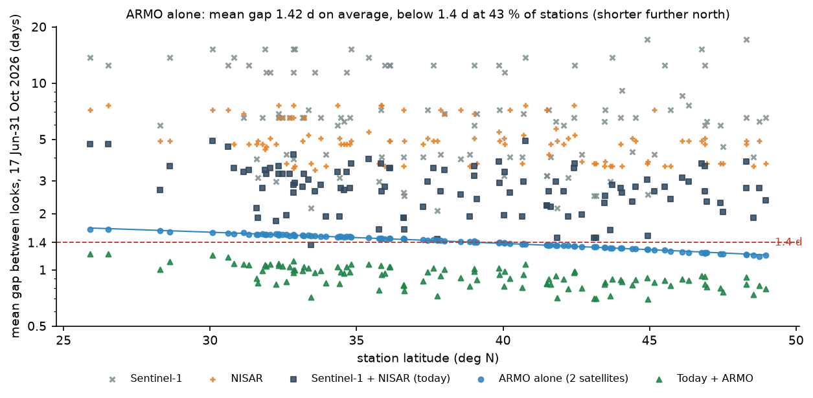
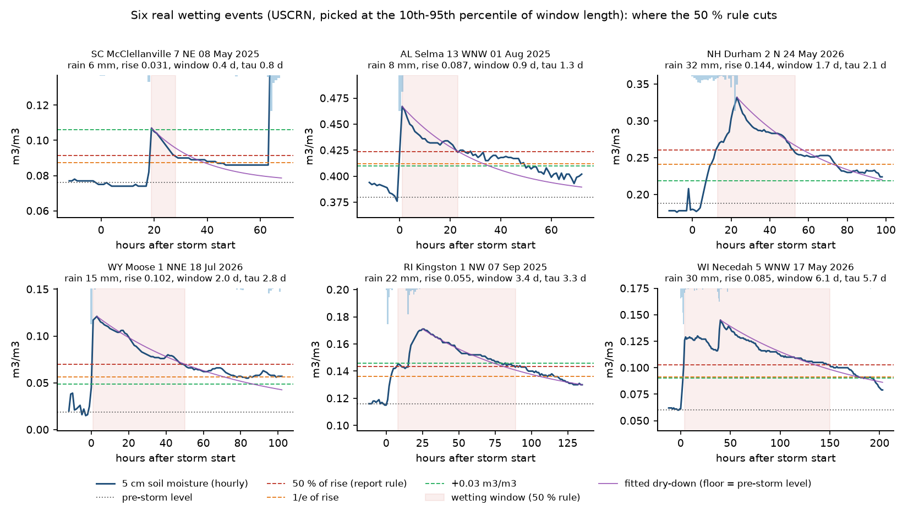
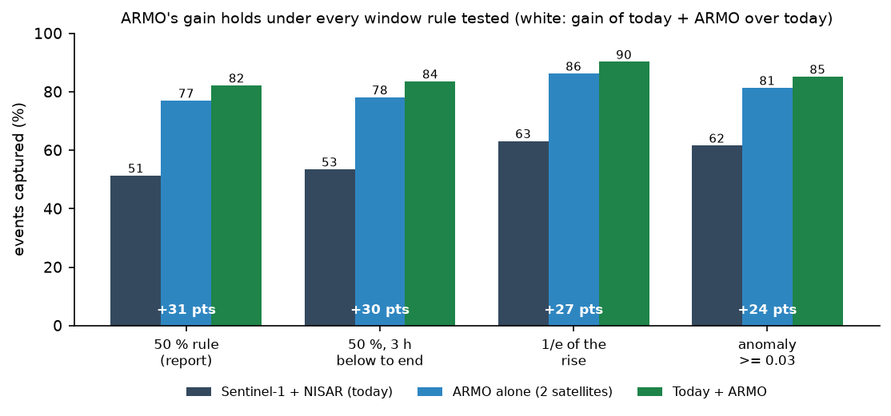
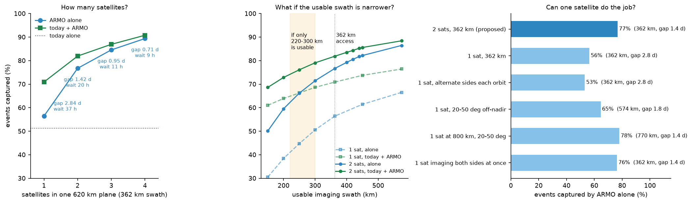
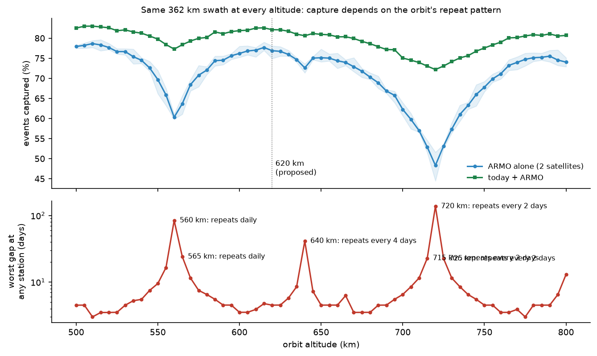
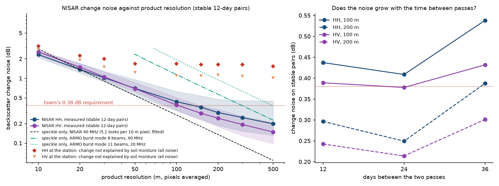
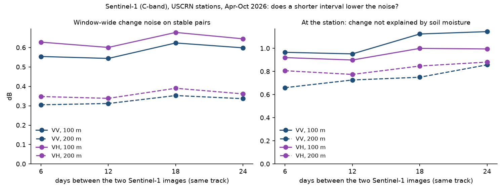

# ARMO: independent re-implementation and additional tests

This is a second, independent implementation of the ARMO analysis. The code was written from the definitions in the
team's report, not copied from the team's repository, so agreement between the two is a real check. It then adds
tests: waiting time, latitude, design sweeps, orbit repeat options and measured L-band noise.
Every number below is produced by a script in `code/` and collected in `data/processed/headline.json`;
`tests/test_numbers.py` checks that this document quotes them correctly.

Evidence labels: **OBSERVED** (ground truth or real acquisitions), **SIMULATED** (orbit model), **MEASURED** (real
radar data), **ASSUMED** (a stated assumption).

## Summary

- The team's capture numbers reproduce to within one point. Today's fleet (Sentinel-1 + NISAR) looks inside 51.3 % of
  982 wetting windows; adding two ARMO satellites raises this to 82.2 %, a paired gain of 30.9 points (95 % CI
  28.0–33.6). ARMO alone captures 77.0 %.
- ARMO also cuts the waiting time from the moment the soil wets to the first look: median 39 hours today, 13 hours with
  ARMO. Today only 35 % of events get a look within 24 hours; with ARMO 74 % do.
- ARMO alone gives a mean gap of 1.42 days averaged over the stations, varying with latitude: 1.54 days south of
  35°N and 1.27 days north of 42°N (below 1.4 days at 43 % of stations). A usable swath of about 440 km brings every
  station below 1.4 days.
- The gain holds under every wetting-window rule we tried (+24 to +31 points). The 50 % rule is the strictest of the four.
- Two satellites are the cheapest way to the 1.4-day gap. One satellite reaches it only by imaging both sides at once
  or by covering a 770 km swath from 800 km, both much harder radars.
- Capture depends on the orbit's repeat pattern, not just altitude. Some nearby altitudes capture far less
  (560 km: 60.3 %; 640 km: 72.6 %; 720 km: 48.3 %). An exact 6-day repeat orbit at 613 km keeps capture (77.1 %),
  shortens the worst gap from 4.5 to 3.0 days and gives a same-geometry reference image every 3 days instead of every 45.
- Measured NISAR pairs show that change noise above about 50 m is real scene change, not speckle: at the station the
  change not explained by soil moisture is about 1.6 dB at every resolution from 100 to 500 m. ARMO's burst mode has
  fewer looks than NISAR, so its speckle also matters (0.95 dB at 200 m with 11 beams at 20 MHz; 0.38 dB at 500 m).

## 1. Ground truth (OBSERVED)

NOAA USCRN hourly02 files for 2025 and 2026 were downloaded and quality-controlled as the team's report describes (frozen or
unknown soil removed, 5 cm values outside 0–0.6 m³/m³ removed, station-seasons with at least 70 % valid hours).
The event rule was re-implemented from the report text (`code/02_events.py`).

| | This re-run | Team report |
|---|---|---|
| Wetting events, 2025–2026 | 3,343 at 120 stations | 3,340 at 120 |
| Median window | 1.79 days | 1.8 days |
| Windows shorter than 48 h | 55 % | 55 % |
| Matched cohort (17 Jun–31 Oct 2026) | 982 events, 107 stations | 979 events, 107 stations |

The small differences come from gap filling (we fill soil-moisture gaps of up to 3 hours).

## 2. Capture: today against ARMO (OBSERVED fleet + SIMULATED ARMO)

Real Sentinel-1 and NISAR look times come from the public catalogues (`code/03_fleet_looks.py`). ARMO looks come from
our own orbit model (`code/04_orbit_sim.py`: J2 sun-synchronous orbit, 620 km, dawn-dusk, right-looking, 25–45°
off-nadir), averaged over 8 starting positions. Confidence intervals resample whole stations (2,000 times).

| System | Capture | 95 % CI | Team report |
|---|---|---|---|
| Sentinel-1 | 30.3 % | 26.2–34.6 | 30.2 % |
| NISAR | 37.4 % | 33.9–41.2 | 37.9 % |
| Sentinel-1 + NISAR (today) | 51.3 % | 47.3–55.6 | 51.6 % |
| ARMO alone (2 satellites) | 77.0 % | 73.7–80.3 | 76.1 % |
| Today + ARMO | 82.2 % | 78.9–85.4 | 81.5 % |

Paired gain of today + ARMO over today: 30.9 points (95 % CI 28.0–33.6); the team reports 29.9 (27.2–32.6).
The other designs also match the team's Table 3 closely (today + design A 71.2 %, B 70.3 %, C 77.7 %, E 77.9 %;
team 71.1, 70.1, 77.2, 77.4).

Counts for today's fleet (982 events): Sentinel-1 looked inside 298 windows, NISAR 367, either 504 (137 Sentinel-1 only,
206 NISAR only, 161 both), none 478. Adding ARMO gains 303 events on average.

## 3. Waiting time: how soon after wetting is the first look? (new)

For each event we measured the hours from the window opening to the first look at or after it. ARMO's waits are pooled
over all 8 starting positions, so their spread is not narrowed by averaging.

| | Today | ARMO alone | Today + ARMO |
|---|---|---|---|
| Median wait | 39 h | 19 h | 13 h |
| Mean wait | 52 h | 21 h | 16 h |
| 90th percentile | 114 h | 44 h | 34 h |
| First look within 24 h | 35 % | 60 % | 74 % |
| Mean gap between looks | 2.81 days | 1.42 days | 0.93 days |
| Worst gap at any station | 20.0 days | 4.5 days | 4.5 days |

The median wait falls by about two-thirds, and the slowest tenth of events wait about 1.4 days instead of almost 5.

## 4. Revisit gap by latitude (SIMULATED)

ARMO alone gives a mean gap of 1.42 days averaged over the 107 stations. Pooling every gap between consecutive looks,
the mean is 1.41 days, the median 1.50, the 90th percentile 2.51 and the longest 4.50 days (today's fleet: 2.51, 1.96,
5.03 and 19.97 days). Because neighbouring swaths overlap more
towards the poles, the gap shrinks northwards: 1.54 days south of 35°N and 1.27 days north of 42°N. Only 43 % of
stations are below 1.4 days. Combined with today's fleet every station is below 1.4 days (mean 0.93 days).

A usable swath of about 440 km brings every station below 1.4 days from ARMO alone (section 7).

## 5. Which events ARMO adds, and which it still misses

- ARMO catches 63 % of the events today's fleet misses.
- Windows of 1–2 days go from 49 % captured today to 89 % with ARMO; windows under 1 day go from 17 % to 45 %.
- The events still missed are the shortest ones. 12 % of windows close within 12 hours, and only 30 % of those are
  captured even with ARMO. Twice-daily sampling cannot catch them. Catching about 90 % of all events would need four
  satellites (section 7).
- About half of the windows open between noon and 21:00 local time (afternoon storms), so the evening dawn-dusk pass
  comes soon after many of them.

## 6. Is the wetting-event definition fair? (OBSERVED)

Three checks of the 50 % rule (`code/06_event_definition.py`):

1. **Where the rule cuts.** The figure shows six real events picked at the 10th–95th percentile of window length, with
   the 50 % line, the 1/e line, the +0.03 m³/m³ line and a fitted dry-down curve. One weakness shows in the first
   panel: a single low hourly reading can end the window early. A version that needs 3 hours in a row below the line
   lengthens the median window only from 1.79 to 1.88 days.
2. **Physical meaning.** Fitting an exponential dry-down from the peak towards the pre-storm level gives a median time
   constant of 2.3 days. The time from the peak to the 50 % crossing is 0.95 times the fitted half-life (tau × ln 2) at the
   median. So the 50 % rule marks where the soil has lost half its added water on a standard dry-down curve.
3. **Does the choice change the result?** No. Among four rules the 50 % rule gives the shortest windows, so it is
   the hardest test for ARMO:

| Window rule | Median window | Today | Today + ARMO | Gain |
|---|---|---|---|---|
| 50 % of rise (report) | 1.79 d | 51 % | 82 % | +31 |
| 50 %, must stay below 3 h | 1.88 d | 53 % | 84 % | +30 |
| 1/e of the rise | 2.46 d | 63 % | 90 % | +27 |
| Anomaly ≥ 0.03 m³/m³ | 2.46 d | 62 % | 85 % | +24 |

14 % of windows are cut short by the next storm; their true length is longer, which again makes capture harder.

**Varying the 50 % itself.** The other checks keep the 50 % fraction fixed, so we also changed the fraction. The
revisit an ideal regular sampler needs for 80 % capture depends strongly on it, but ARMO's advantage does not
(`code/13_review_checks.py`):

| Window ends at | Median window | Regular sampler 1 / 2 / 3 / 6 days | Revisit for 80 % | Today | ARMO alone | Today + ARMO |
|---|---|---|---|---|---|---|
| 25 % of the rise | 74 h | 97.3 / 89.9 / 80.3 / 56.6 % | 3.03 d | 71.1 % | 91.9 % | 94.9 % |
| 37 % (1/e) | 59 h | 93.7 / 82.9 / 71.6 / 47.5 % | 2.25 d | 63.1 % | 86.2 % | 90.2 % |
| 50 % (report) | 43 h | 86.8 / 72.3 / 59.7 / 36.9 % | 1.45 d | 51.3 % | 77.0 % | 82.2 % |
| 75 % of the rise | 15 h | 60.9 / 41.9 / 31.1 / 17.0 % | 0.42 d | 26.4 % | 47.7 % | 54.9 % |
| Anomaly ≥ 0.03 m³/m³ | 59 h | 88.0 / 77.5 / 68.1 / 48.2 % | 1.75 d | 61.6 % | 81.3 % | 85.2 % |

The 1.46-day revisit therefore applies to the 50 % definition. The 75 % rule describes only the first few hours after
the peak, which no twice-daily radar can follow.

## 7. Design choices (SIMULATED)

All runs: 12 starting positions, same cohort, scored alone and with today's fleet (`code/09_design_sweeps.py`).
Numbers can differ by a few tenths from section 2, which uses 8 starting positions.

**How many satellites** (620 km, 362 km swath, one plane):

| Satellites | ARMO alone | Today + ARMO | Mean gap | Median wait |
|---|---|---|---|---|
| 1 | 56.4 % | 70.9 % | 2.84 d | 37 h |
| 2 (proposed) | 76.7 % | 81.9 % | 1.42 d | 20 h |
| 3 | 84.5 % | 86.9 % | 0.95 d | 11 h |
| 4 | 89.4 % | 90.8 % | 0.71 d | 9 h |

**If the usable imaging swath is smaller (or larger) than the 362 km access** (2 satellites):

| Usable swath | ARMO alone | Today + ARMO | Mean gap | Stations below 1.4 d |
|---|---|---|---|---|
| 200 km | 59.5 % | 72.8 % | 2.57 d | 0 % |
| 250 km | 66.2 % | 76.1 % | 2.06 d | 0 % |
| 300 km | 71.5 % | 79.1 % | 1.72 d | 0 % |
| 400 km | 79.2 % | 83.5 % | 1.29 d | 88 % |
| 420 km | 80.6 % | 84.3 % | 1.23 d | 98 % |
| 440 km | 81.7 % | 85.3 % | 1.17 d | 100 % |

**Two satellites against the best single satellite, paired.** The team's best single-satellite design (C: left and
right on alternate orbits, 20–50° off-nadir) captures 68.6 % alone and 77.7 % with today's fleet. Scored event by
event against design D, two satellites win by 8.4 points alone (95 % CI 7.1 to 9.7) and 4.4 points with today's fleet
(95 % CI 3.4 to 5.6). The unpaired intervals overlap, but the paired difference is clearly above zero.

**Without NISAR.** NISAR's prime mission is three years, so it may end before ARMO flies. Sentinel-1 + ARMO alone
still captures 79.4 % (95 % CI 76.2-82.8), against 30.3 % for Sentinel-1 by itself.

**One satellite instead of two:**

| Option | ARMO alone | Today + ARMO | Swath | Mean gap |
|---|---|---|---|---|
| 1 satellite, 362 km | 56.4 % | 70.9 % | 362 km | 2.84 d |
| 1 satellite, left and right on alternate orbits | 53.1 % | 70.4 % | 362 km | 2.81 d |
| 1 satellite, 20–50° off-nadir, right-looking only | 64.5 % | 75.6 % | 574 km | 1.79 d |
| 1 satellite at 800 km, 20–50° | 78.0 % | 82.8 % | 770 km | 1.38 d |
| 1 satellite imaging both sides at once | 76.3 % | 81.9 % | 2 × 362 km | 1.40 d |
| 2 satellites (proposed) | 76.7 % | 81.9 % | 362 km | 1.42 d |

One satellite matches two only if it images about twice the ground per pass: a 770 km swath from 800 km, or both
sides at once. Either means roughly twice the radar power and data rate on one spacecraft, a longer range (worse noise)
and, for ScanSAR, coarser resolution. Radar numbers: `code/sar_tradeoff.py` and `data/processed/feas_*.csv`.

**Other choices that do not help:**
- Time of day: dawn-dusk (76.7 %), 10:30 (77.0 %) and 13:30 (77.0 %) orbits capture the same. Keep dawn-dusk for
  power.
- Alternating look sides with two satellites: 68.8 % against 76.7 % for both right-looking.
- Putting the second satellite in a different plane (10:30): 71.4 %. One plane, 180° apart, is better.
- Looking both sides every pass (an upper bound, not a real design): 81.8 % alone, gap 0.70 days.

## 8. Orbit altitude and repeat cycle (SIMULATED)

With the swath fixed at 362 km, capture still swings with altitude. A sun-synchronous orbit whose revolutions per
day are close to a simple fraction repeats its ground track after a few days, so its swaths stack on the same strips:

| Altitude | Repeats after | ARMO alone | Worst gap at a station |
|---|---|---|---|
| 560 km | 1 day | 60.3 % | 84 days |
| 620 km (proposed) | (no short repeat) | 76.9 % | 4.5 days |
| 640 km | 4 days | 72.6 % | 41 days |
| 720 km | 2 days | 48.3 % | 137 days |

The proposed 620 km sits in a good band (about 600–625 km), but the 640 km repeat is only 20 km away, so the orbit is
best specified as a repeat cycle held by station-keeping, not only an altitude.

The 620 km orbit never repeats its ground track over a short cycle, so a station is seen from about 40 different
geometries and the same geometry comes back only every 45 days. Change detection
compares an image inside the window with a "before" image from the same geometry; otherwise incidence-angle
differences (several dB at L-band between 25° and 45°) swamp a soil-moisture signal of about 1 dB per 0.1 m³/m³.

An exact 6-day repeat orbit (89 revolutions in 6 days) at 613 km changes this (`data/processed/repeat_orbit_options.csv`):

| Orbit | ARMO alone | Today + ARMO | Worst gap | Same geometry again after |
|---|---|---|---|---|
| 620 km as proposed | 76.9 % | 82.1 % | 4.5 d | 45 days |
| 613 km, exact 6-day repeat | 77.1 % | 82.4 % | 3.0 d | 3 days |

With two satellites 180° apart and an even repeat cycle, the second satellite retraces the first one's tracks half a
cycle later, so every geometry comes back every 3 days, as for Sentinel-1A/B (12-day repeat, 6 days apart). The same
shared track pattern leaves stations that fall between swaths south of about 37°N seen less often: four Gulf-coast
stations average 2.0–2.3 days between looks at 613 km, against at most 1.66 days at 620 km
(`report-support/gap_by_orbit.py`).

## 9. Can ARMO see the change, not just look? (MEASURED, NISAR data)

We tested whether change noise is speckle, using real NISAR GCOV images
(10 m, HH and HV, 40 MHz) in 5.12 km windows around 16 USCRN stations, 17 Jun–31 Oct 2026: 1,212 same-track pairs
(`code/07_nisar_windows.py`, `code/08_noise_vs_resolution.py`). Pairs are two passes from the same track 12, 24 or 36
days apart; "stable" pairs have a station soil-moisture change below 0.01 m³/m³ and no rain in the 3 hours before
either pass.

| Product resolution | NISAR HH, measured | NISAR HV, measured | Speckle only, NISAR | Speckle only, ARMO 8 beams 40 MHz | Speckle only, ARMO 11 beams 20 MHz |
|---|---|---|---|---|---|
| 10 m | 2.33 dB | 2.56 dB | 2.85 dB | – | – |
| 100 m | 0.44 dB | 0.39 dB | 0.27 dB | 1.14 dB | 1.93 dB |
| 200 m | 0.30 dB | 0.24 dB | 0.14 dB | 0.57 dB | 0.95 dB |
| 500 m | 0.20 dB | 0.15 dB | 0.05 dB | 0.23 dB | 0.38 dB |

Measured noise = median over stable 12-day pairs of the robust spread of the block-by-block dB change across the
window, after removing the window-wide shift. NISAR's speckle curve uses 5.1 looks per 10 m pixel, fitted at 10–30 m.
ARMO's burst-mode looks come from `code/sar_tradeoff.py` (`data/processed/feas_modes.csv`: 48 × 7.1 m or 66 × 14.3 m single look).

What this shows:

1. **NISAR is speckle-limited only below about 50 m.** Above 100 m its measured noise sits well above the speckle
   curve, so the rest is real change in the scene: crops growing, tillage, irrigation, dew.
2. **At a single point the noise is much larger and does not average away.** The change in HH not explained by the
   station's soil-moisture change has a standard deviation of 1.7 dB at 100 m, 1.6 dB at 200 m and 1.5 dB at 500 m
   (HV about 1.1 dB). Averaging more pixels barely reduces it. (The distribution has heavy tails: its robust spread at
   200 m is 0.68 dB.)
3. **ARMO is different from NISAR.** NISAR's 12 m antenna images its wide swath at full resolution. ARMO's 5.9 m
   antenna needs a burst mode, which leaves far fewer looks per cell: speckle on a change is 0.57 dB at 200 m with 8 beams
   at 40 MHz, 0.95 dB with 11 beams at 20 MHz. So for ARMO speckle matters, and bandwidth and beam count set it (table above).
4. **HH carries the soil signal.** HH changes by 0.86 dB per 0.1 m³/m³ at 200 m (95 % CI 0.49–1.31); HV only 0.33. HV is
   for tracking vegetation.
5. **Interval length.** On the window-wide measure, 200 m HH noise was 0.30 dB for 12-day pairs (69 pairs), 0.25 dB
   for 24-day (43) and 0.39 dB for 36-day (21). NISAR cannot test intervals shorter than 12 days; section 9b uses
   Sentinel-1 6-day pairs for that.

A no-change noise target for same-geometry pairs (for example 0.4 dB in a 200 m cell) can be tested with this method.

## 9b. Do shorter "before and after" intervals lower the noise? (MEASURED, Sentinel-1)

NISAR only repeats every 12 days. In 2026 Sentinel-1C and 1D fly 180° apart on the same tracks, so many US stations
have same-track pairs 6 days apart as well as 12 (`code/12_s1_pair_noise.py`, `code/12b_s1_noise_by_interval.py`;
19 stations, 3,132 pairs, Apr–Oct 2026). C-band responds more to vegetation than L-band, so this is a cautious
stand-in, not a measurement of ARMO.

| Days between images | Stable pairs | Window-wide VV noise, 200 m | At the station: VV change not explained by soil moisture, 200 m |
|---|---|---|---|
| 6 | 364 | 0.31 dB | 0.66 dB |
| 12 | 469 | 0.31 dB | 0.73 dB |
| 18 | 289 | 0.35 dB | 0.75 dB |
| 24 | 375 | 0.34 dB | 0.86 dB |

Station by station, the 12-day noise is 1.04 times the 6-day noise (95 % CI 0.78–1.11, 14 stations): no clear
difference. At the station the unexplained change grows slowly with the interval (about 10 % from 6 to 12 days and
30 % from 6 to 24). So shorter intervals help, but only a little; most of the noise is already there after a few days.
ARMO's main gain is therefore capture and waiting time, with a modest gain in change noise.

## 10. Scope and assumptions

- **One season.** The matched cohort is 17 June–31 October 2026, the only continuous NISAR record. Winter, spring
  and a second summer are not tested.
- **Few croplands.** Only 9 of 121 stations are cropland (team repo). Capture does not depend on land cover, but
  detection does.
- **Capture is not detection.** A look inside the window does not mean the change was detected (section 9; team repo
  section 5).
- **Access is not imaging.** All ARMO runs assume the radar images the full 362 km on every pass. If only 220–300 km
  is usable, capture with today's fleet falls to about 75–79 % (section 7).
- **Idealised orbit.** Circular orbit, J2 only, no drag, no manoeuvres, no downtime, no conflicts with other
  imaging. Real duty cycles will lower ARMO's numbers somewhat.
- **Point stations.** Capture is scored at the probe location; a 100–200 m product averages over a larger area.

## Method notes

- **Look:** a pass that images the station (frames less than 1 hour apart count once). ARMO looks happen at zero
  Doppler when the station is 25–45° off-nadir on the looking side.
- **Captured:** at least one look inside the window. **Wait:** hours from the window opening to the next look.
- **Mean gap:** days in the period divided by looks at that station; "worst gap" is the longest gap between two looks.
- **Starting positions:** each design is flown from 8 (section 2) or 12 (sections 7–8) evenly spaced starting
  points along the orbit and averaged.
